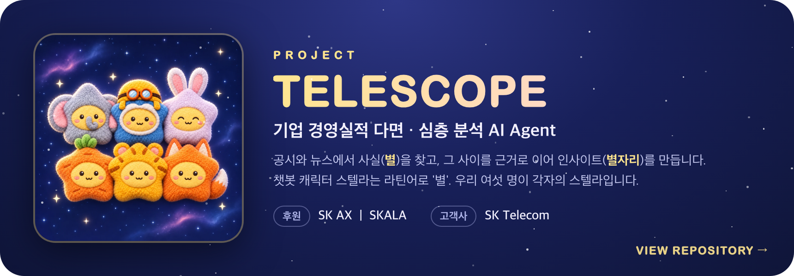
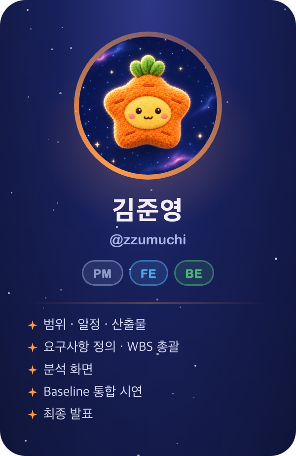
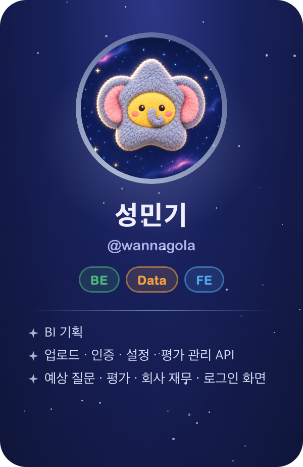
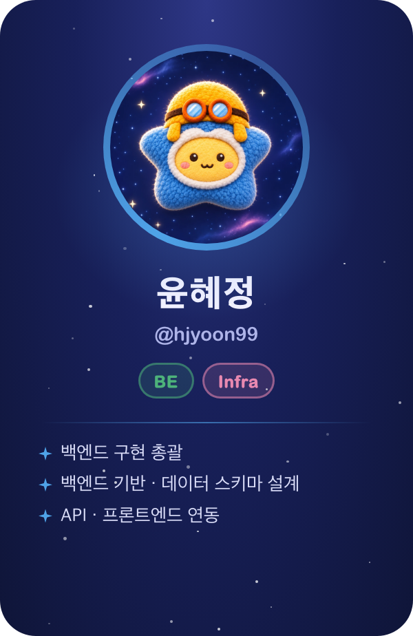
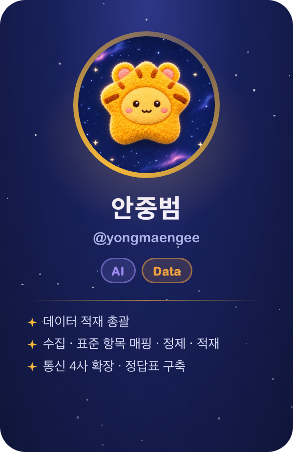
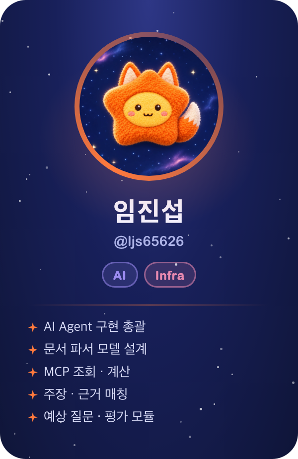

  

<h3 align="center">망원경처럼 멀리 <b>바</b>라보고, 흩어진 근거를 <b>모</b>아, 하나의 <b>스</b>토리로 잇습니다.</h3>

 

  

 

<h2 align="center">Members</h2>

여섯 개의 별이 모여 하나의 별자리가 됩니다. 카드를 누르면 각자의 GitHub로 이동해요.

  
  
  

  
  
  

 

Team Vamos · SK AX SKALA

