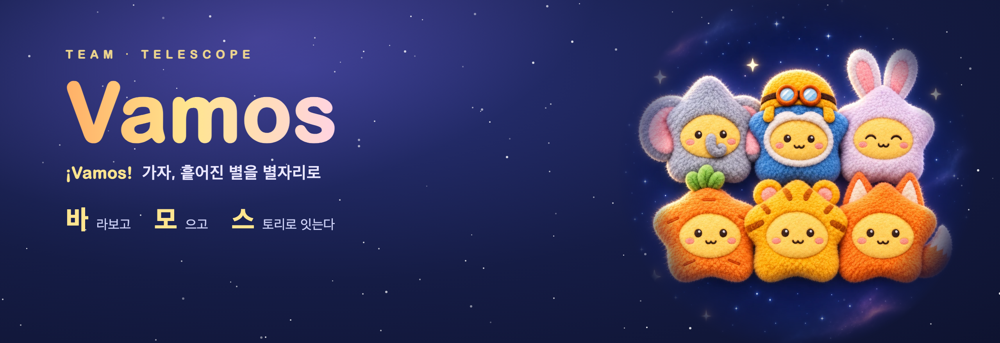
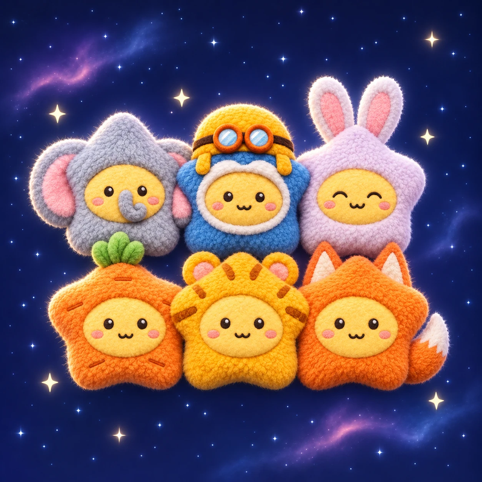
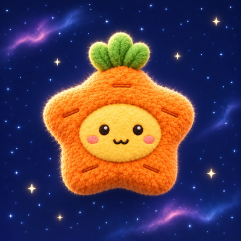
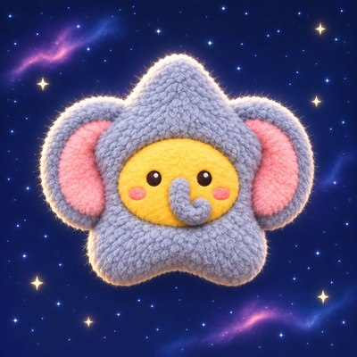
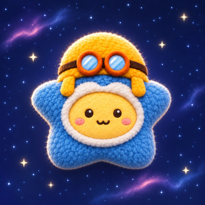
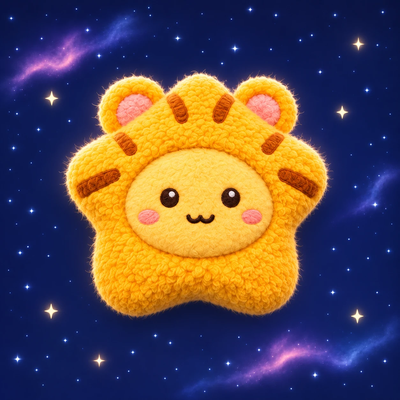
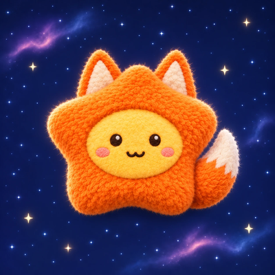
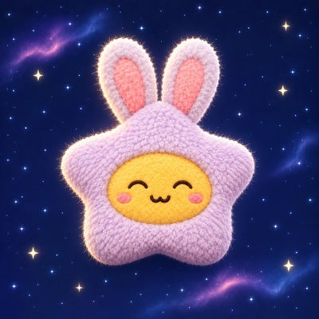

  

  망원경처럼 멀리 <b>바</b>라보고, 흩어진 근거를 <b>모</b>아, 하나의 <b>스</b>토리로 잇습니다.

 

<table align="center">
  <tr>
    <td width="260" align="center">
      
    </td>
    <td width="440">
      <h3><a href="https://github.com/vamos-team/telescope">TELESCOPE</a></h3>
      기업 경영실적 다면 · 심층 분석 AI Agent  
      공시와 뉴스에서 사실(별)을 찾고, 그 사이를 근거로 이어 해석(별자리)을 만듭니다. 
      챗봇 캐릭터 <b>스텔라</b>는 라틴어로 '별'. 우리 여섯 명이 각자의 스텔라입니다.  
      
    </td>
  </tr>
</table>

 

<h2 align="center">Members</h2>

<table align="center">
  <tr>
    <td align="center" valign="top" width="33%">
      
      <h3><a href="https://github.com/zzumuchi">김준영</a></h3>
      <a href="https://github.com/zzumuchi">@zzumuchi</a>  
          
      범위 · 일정 · 산출물 관리 요구사항 정의 · WBS 총괄 분석 화면 Baseline 통합 시연 최종 발표
    </td>
    <td align="center" valign="top" width="33%">
      
      <h3><a href="https://github.com/wannagola">성민기</a></h3>
      <a href="https://github.com/wannagola">@wannagola</a>  
          
      BI 기획 업로드 · 인증 · 설정 · 평가 관리 API 예상 질문 · 평가 · 회사 재무 · 로그인 화면
    </td>
    <td align="center" valign="top" width="33%">
      
      <h3><a href="https://github.com/hjyoon99">윤혜정</a></h3>
      <a href="https://github.com/hjyoon99">@hjyoon99</a>  
         
      백엔드 구현 총괄 백엔드 기반 · 데이터 스키마 설계 API · 프론트엔드 연동
    </td>
  </tr>
  <tr>
    <td align="center" valign="top" width="33%">
      
      <h3><a href="https://github.com/yongmaengee">안중범</a></h3>
      <a href="https://github.com/yongmaengee">@yongmaengee</a>  
         
      데이터 적재 총괄 수집 · 표준 항목 매핑 · 정제 · 적재 통신 4사 확장 · 정답표 구축
    </td>
    <td align="center" valign="top" width="33%">
      
      <h3><a href="https://github.com/ljs65626">임진섭</a></h3>
      <a href="https://github.com/ljs65626">@ljs65626</a>  
         
      AI Agent 구현 총괄 문서 파서 모델 설계 MCP 조회 · 계산 주장 · 근거 매칭 예상 질문 · 평가 모듈
    </td>
    <td align="center" valign="top" width="33%">
      
      <h3><a href="https://github.com/yuni-ju">주윤겸</a></h3>
      <a href="https://github.com/yuni-ju">@yuni-ju</a>  
         
      테스트 · 검증 총괄 배포 환경 문서 파서 · 임베딩 모델 첨부 적합성 검사
    </td>
  </tr>
</table>

 

  
  
  
  
  
  

Team Vamos · SKALA

